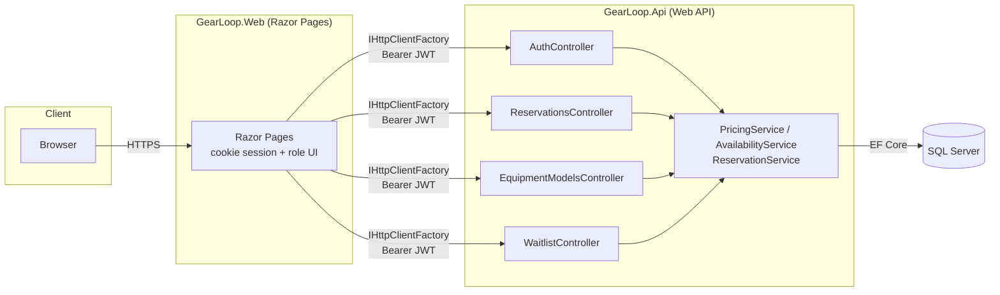

# GearLoop

[](https://github.com/edu-tech220/gearloop/actions/workflows/ci.yml)
[](https://dotnet.microsoft.com/)
[](https://www.microsoft.com/sql-server)
[](https://www.docker.com/)

Outdoor and photography equipment rental platform built as two ASP.NET Core 8 microservices: a
**Web API** backend with the business rules and a **Razor Pages** frontend that talks to it over
HTTP, never to the database directly.

## What it solves

A rental shop (cameras, drones, tents...) needs to know, for any model/branch/date range, whether
it can promise a unit to a customer without ever promising the same physical unit twice - while
also handling no-shows, late returns, damaged gear and a waitlist for popular items. GearLoop
models that as a small reservation engine instead of a plain CRUD:

- **Capacity math, not row locking, for browsing.** Availability for a date range is the rentable
  unit count minus overlapping active reservations - a pure read, safe to call as often as the UI
  needs without touching a specific row.
- **Optimistic concurrency only where it matters.** The one moment two staff members can race for
  the same physical unit is checkout. `EquipmentUnit` and `Reservation` carry an app-managed
  concurrency token (refreshed on every state transition) and `CheckoutAsync` retries against a
  fresh "first available unit" query when it loses a race, instead of ever double-assigning a unit.
- **A FIFO waitlist that promotes itself.** Cancelling or returning a unit automatically walks the
  waitlist in request order and confirms the first entry that now fits, no manual re-booking.

## Business rules

| Rule | Where |
|---|---|
| Availability = rentable units − overlapping `Confirmed`/`CheckedOut` reservations for that model+branch+range | `AvailabilityService` |
| Units in `Maintenance` or `Retired` never count toward capacity | `AvailabilityService` |
| Rentals: 3+ days get a 10% discount, 7+ days get 15%; a 10%/day surcharge applies on weekend days covered | `PricingService` |
| Late return: 1.5× the daily rate per day overdue | `PricingService` |
| Damage on return forfeits a fraction of the deposit (`Fair` 25%, `Damaged` 75%, `Retired` 100%), capped at the deposit | `PricingService` |
| Reservation state machine: `Confirmed → CheckedOut → Returned`, or `Confirmed → Cancelled` | `ReservationService` |
| Checkout claims a pooled unit under optimistic concurrency with a bounded retry loop | `ReservationService.CheckoutAsync` |
| A returned `Damaged`/`Retired` unit goes to `Maintenance` instead of back into the pool | `ReservationService.ReturnAsync` |
| No free capacity + opt-in → joins a FIFO waitlist; cancellation/return promotes the next fitting entry | `ReservationService` |
| Rentals are capped at 30 days and can't start in the past | `ReservationService.CreateReservationAsync` |

## Architecture



The frontend holds no business logic and no direct database connection: it signs the user into a
cookie that carries the API's JWT as a claim, then forwards that bearer token on every call made
through a typed `HttpClient`.

## Technical decisions

- **Portable optimistic concurrency.** `RowVersion` on `EquipmentUnit`/`Reservation` is an
  app-managed token (`IsConcurrencyToken()`), not a SQL Server-native `rowversion`. The service
  layer assigns a fresh value on every state change, so the exact same model and code enforce
  concurrency identically on SQL Server (production) and SQLite (tests) - a database-generated
  `rowversion` only auto-updates on SQL Server.
- **EnsureCreated for SQLite, Migrate for SQL Server.** Migrations are scaffolded against SQL
  Server syntax; the test host detects the active provider and builds the schema straight from the
  model instead of replaying SQL Server-specific DDL against SQLite.
- **Projections over includes.** List/detail endpoints `Select()` straight into DTOs in a single
  query instead of `Include()`-ing navigation properties, so paging equipment models or
  reservations never turns into N+1 round trips.
- **Cookie-session + bearer-token bridge.** The Web project authenticates its own users with a
  cookie (so Razor Pages can use plain `[Authorize(Roles=...)]`) while stashing the API's JWT as a
  claim to forward on outgoing API calls - the frontend never talks to SQL Server directly.
- **IExceptionHandler → ProblemDetails.** Domain exceptions (`NotFoundException`,
  `ValidationException`, `ConflictException`) map to RFC 7807 responses through a single
  `IExceptionHandler`, keeping controllers free of repetitive try/catch.

## Endpoints

| Method | Route | Auth | Description |
|---|---|---|---|
| POST | `/api/auth/register` | Public (rate-limited) | Create a Customer account, returns a JWT |
| POST | `/api/auth/login` | Public (rate-limited) | Returns a JWT for an existing account |
| GET | `/api/branches` | Public | List branches |
| GET | `/api/equipment-models` | Public | Paged equipment list, `category` filter |
| GET | `/api/equipment-models/{id}` | Public | Equipment model details |
| GET | `/api/equipment-models/{id}/availability` | Public | Free unit count for a branch/date range |
| POST | `/api/reservations` | Customer | Create a reservation, or join the waitlist if full |
| GET | `/api/reservations/mine` | Customer | The caller's own reservations, paged |
| GET | `/api/reservations/{id}` | Owner or Staff/Admin | Reservation detail |
| POST | `/api/reservations/{id}/cancel` | Owner or Staff/Admin | Cancel a `Confirmed` reservation |
| GET | `/api/reservations` | Staff/Admin | All reservations, paged, filter by status |
| POST | `/api/reservations/{id}/checkout` | Staff/Admin | Assign a unit, move to `CheckedOut` |
| POST | `/api/reservations/{id}/return` | Staff/Admin | Record return, apply late/damage fees |
| GET | `/api/waitlist` | Staff/Admin | Paged waitlist entries |

Swagger UI is available at `/swagger` when the Api runs in Development.

## Running it

### Docker Compose (Api + Web + SQL Server)

```bash
docker compose up --build
```

- Web: http://localhost:8081
- Api + Swagger: http://localhost:8080/swagger

### Locally with `dotnet run`

A local SQL Server instance is required (or point `ConnectionStrings:DefaultConnection` in
`src/GearLoop.Api/appsettings.json` at one you already have running).

```bash
dotnet run --project src/GearLoop.Api    # http://localhost:5077, applies migrations + seeds data
dotnet run --project src/GearLoop.Web    # http://localhost:5179, already configured to call the Api above
```

### Demo accounts (seeded on startup)

| Role | Email | Password |
|---|---|---|
| Admin | `admin@gearloop.dev` | `Admin#2024` |
| Staff | `staff@gearloop.dev` | `Staff#2024` |

## Testing

```bash
dotnet test
```

40 tests, no external services required: pricing/availability unit tests, a full reservation
state-machine + waitlist-promotion suite against an in-memory SQLite `DbContext`, a focused test
proving the concurrency token rejects a stale update, and end-to-end Api tests (auth, the full
reservation lifecycle, role-based 401/403s, staff checkout/return, pagination and rate limiting)
via `WebApplicationFactory`.
